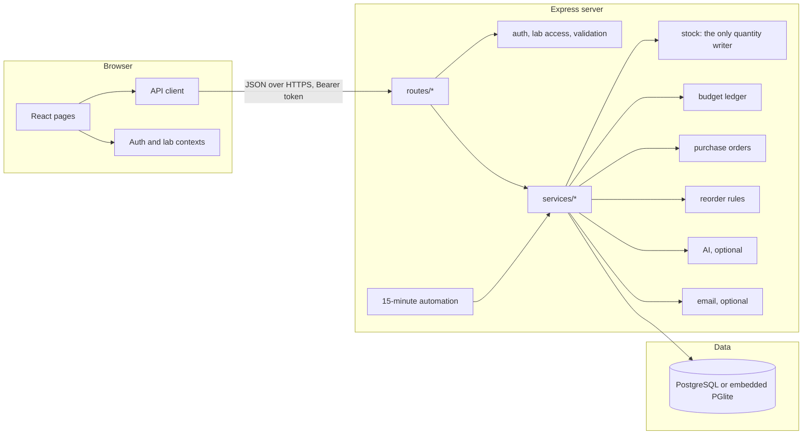
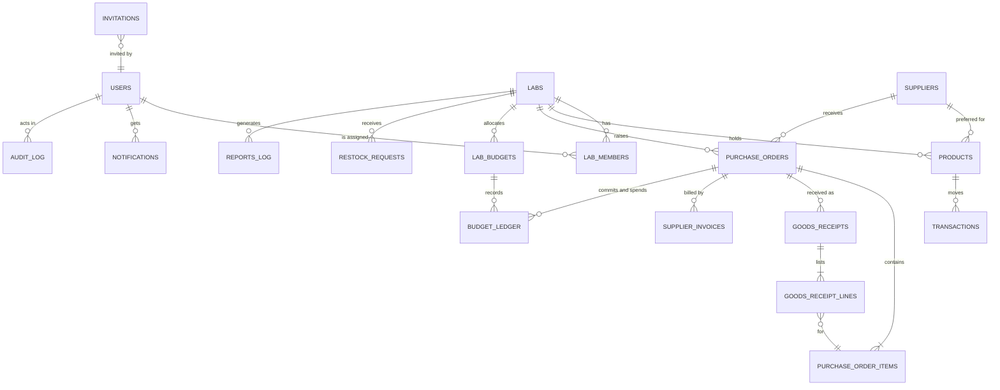
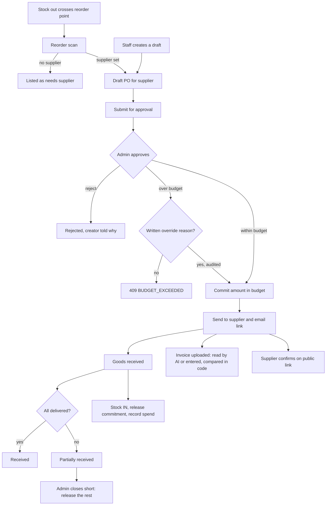

# StockSense architecture

## Components

Every route checks the caller's role and lab membership on the server. Every write that changes money or stock runs in a transaction that also writes an audit row.

## Data model

`transactions`, `budget_ledger`, `goods_receipts` and `audit_log` are append-only. The application has no endpoint that updates or deletes them.

## Procurement workflow

Stock changes only at receipt, never at send or invoice time.

## Background jobs

A cron job runs every 15 minutes (`server/services/automation.ts`). For each lab it runs the reorder scan, and in automatic mode it submits, approves and sends drafts under the lab's limit when the budget allows. Anything else is left as a draft and an administrator is notified. The administrator can run the same job from Settings.
